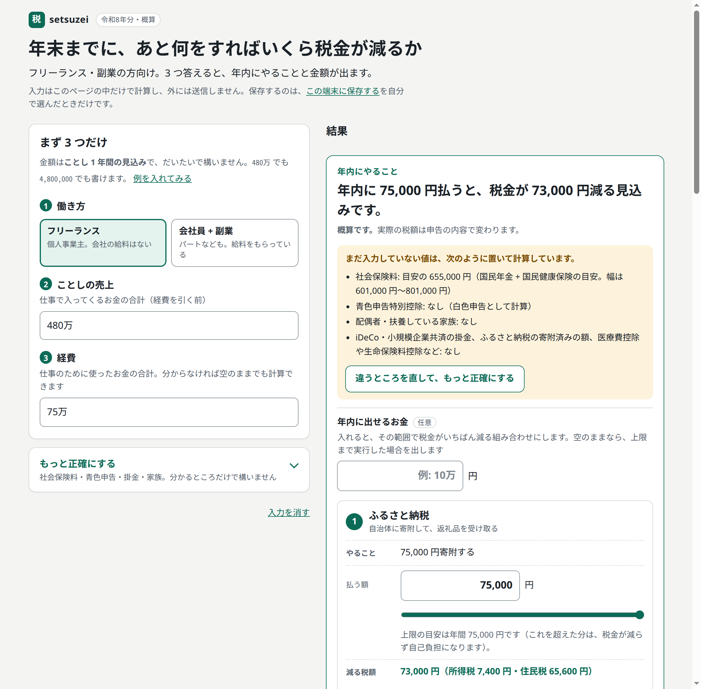

# setsuzei

[](https://github.com/ozko00/setsuzei/actions/workflows/ci.yml)
[](https://www.npmjs.com/package/setsuzei)

日本語 | [English](README.en.md)

**LLM に日本の税額を暗算させないための、出典つき・テスト済みの計算エンジンです。** MCP サーバー / CLI / Agent Skill / ブラウザ版で使えます。

フリーランス・副業の人の、令和8年分（2026年分）の所得税と住民税を概算し、**ふるさと納税・iDeCo・小規模企業共済・青色申告特別控除**で年内にあといくら税金が減るかを出します。確定申告のときには、**医療費控除（セルフメディケーション税制との比較）・生命保険料控除**も入れて、計算した金額が**確定申告書（第一表・第二表）のどの欄**に当たるかを出します。

> **A cited, tested calculation engine so that LLMs don't have to do Japanese tax arithmetic in their heads** (income tax and resident tax, tax year 2026 / Reiwa 8). MCP server, CLI, Agent Skill and browser version. Local only, zero runtime dependencies. Estimates only; not tax advice. → [README in English](README.en.md)

- **数値はすべて一次情報から**: 税率・控除額・上限は、国税庁・総務省・e-Gov の条文などで確かめた数値だけを使い、数値ごとに出典の URL を付けています（[`src/data/2026.ts`](src/data/2026.ts)）。
- **200 件を超えるテスト**: 国税庁や総務省が公表している計算例との突き合わせ、境界値、条文の式から手計算した期待値（[テストでの突き合わせ](#テストでの突き合わせ)）。
- **モデルは計算しない**: エージェントは利用者の数字をツールに渡し、返ってきた数字をそのまま伝えます。出力は構造化されていて、概算である旨・前提・出典が必ず付きます。
- **手元だけで動く**: 外部と通信しません。実行時の依存パッケージはなく、`npx setsuzei` で入るのは 1 パッケージだけです。

> [!IMPORTANT]
> 結果は概算です。税理士や税務署・市区町村の判断に代わるものではありません。重要な判断の前に、必ず専門家か所轄の窓口に確認してください。

## エージェントに入れる

Node.js 20 以上が必要です。

### Claude Code（プラグイン）

Claude Code の中で、次の 2 行を実行します。

```
/plugin marketplace add ozko00/setsuzei
/plugin install setsuzei@setsuzei
```

MCP サーバー（下の 5 つのツール）と Agent Skill がまとめて入ります。端末からなら `claude plugin marketplace add ozko00/setsuzei` と `claude plugin install setsuzei@setsuzei` です。MCP サーバーは、はじめて使うときに npm から `setsuzei`（版を固定。ほかのパッケージは入りません）を取得して、手元で動きます。

### MCP サーバー

`setsuzei mcp` は、標準入出力（stdio）で動く MCP サーバーです。クライアントの MCP の設定に、次を足します。

```json
{
  "mcpServers": {
    "setsuzei": {
      "command": "npx",
      "args": ["-y", "setsuzei@0.6.0", "mcp"]
    }
  }
}
```

Claude Code に MCP サーバーだけを入れるなら、次の 1 行です。

```sh
claude mcp add setsuzei -- npx -y setsuzei@0.6.0 mcp
```

版（`@0.6.0`）は付けたままにしてください。`mcp` は 0.4.0 からで、版を付けないと、以前に `npx setsuzei` を実行したときの古い版が手元に残っていて、それが使われることがあります（その場合、接続に失敗します）。

| ツール | 返すもの |
| --- | --- |
| `estimate_tax_savings` | いまの所得税・住民税と、策ごとの上限・残り枠・減る税額、まとめて実行した場合（計算し直した額）。医療費控除・生命保険料控除と、確定申告書のどの欄に書くか（`filing`）も返す |
| `furusato_nozei_limit` | ふるさと納税の上限の目安・残り・減る税額だけ |
| `compare_furusato_limit_with_2025` | 同じ入力での、令和7年分と令和8年分の上限と、変わった理由 |
| `validate_tax_input` | 入力の誤りの一覧（計算はしない） |
| `list_tax_sources` | 数値の根拠にした一次情報の一覧 |

- 入力は年額・円・整数です。知らない項目や整数でない金額は、モデルが直してやり直せる文面で拒みます。
- どの結果にも `meta`（`estimate: true`、免責、前提、計算していないもの、出典）が付きます。結果の中の注記と注意は日本語です。
- 対応している MCP の版: 現行の 2026-07-28（リクエストごとに版を名乗る方式。`server/discover` に対応）と、それ以前の、接続時に版を決める方式（2025-11-25 / 2025-06-18 / 2025-03-26 / 2024-11-05）。提供するのはツールだけです。
- 動作を確かめたクライアント: Claude Code、公式の MCP Inspector（CLI）、公式 TypeScript SDK のクライアント。**Claude Desktop では未確認**です（上の設定は標準の書き方です）。
- 公式 SDK は使わず、JSON-RPC を自前で処理しています（依存を増やさないため）。壊れた JSON・巨大な入力・知らないメソッド・型の違う引数で落ちないことをテストしています。

### Agent Skill

[`skills/setsuzei/SKILL.md`](skills/setsuzei/SKILL.md) は、エージェントに「必要な項目を聞く → CLI を実行する → 結果を説明する（自分では計算しない）」をさせる手順書です。入れ方は[下の節](#agent-skill-として使う)にあります。

### CLI

```sh
npx setsuzei --revenue 800万 --expenses 150万 --blue 65 --social-insurance 90万 --json
```

`--json` の出力は、MCP のツールが `result` に入れて返すものと同じ形です。フラグの一覧は[使い方](#使い方)にあります。

## モデルだけで答えさせた場合との違い（測った結果）

2026-11-27 に、同じ 3 つの問いを、モデルだけ（Claude Sonnet 5.5、ツールなし、各 3 回）と、setsuzei の MCP ツールあり（各 1 回）で答えさせました。

| 問い（令和8年分） | 正しい値 | モデルだけ（3 回） | ツールあり |
| --- | --- | --- | --- |
| 給与 500 万円・社会保険料 75 万円・独身の、ふるさと納税の上限 | 57,000 円 | 57,000 / **61,000** / **61,000** | 57,000 |
| フリーランス（売上 800 万円・経費 150 万円・青色 65 万円・社会保険料 90 万円）の、所得税 + 住民税 | 891,900 円 | 891,900 / 891,900 / 891,900 | 891,900 |
| フリーランス（売上 480 万円・経費 75 万円・青色 65 万円・社会保険料 59 万円）の、ふるさと納税の上限 | 57,000 円 | **61,000** / **61,000** / **61,000** | 57,000 |

- モデルだけでも、税額の合計は 3 回とも合っていました。外れたのはふるさと納税の上限で、6 回のうち 5 回が 61,000 円でした。これは令和7年分までの値で、令和8年分は基礎控除の引上げでこの所得帯の上限が 57,000 円に下がります。
- 問いは 3 つ、モデルは 1 種類だけの小さな測定です。ほかのモデルや問いでどうなるかは測っていません。問いの全文・方法・限界は [evaluation/model-vs-tool.md](evaluation/model-vs-tool.md) にあります。

## ブラウザ版（エージェントを使わない人向け）

**<https://ozko00.github.io/setsuzei/>**（インストール不要。入力はブラウザの中だけで処理します）

English version: **<https://ozko00.github.io/setsuzei/en/>**（日本に住む英語話者のフリーランス・会社員向け。トップと説明ページ 7 枚。計算は日本語版と同じ計算コアで、同じ入力なら同じ数字になります）

<p>
  
  
</p>

上はブラウザ版の実際の画面です（「例を入れてみる」を押したところ）。はじめは**働き方・売上・経費の 3 つ**だけ答えれば結果が出ます。社会保険料などの残りの値は目安や既定で置き、どう置いたかを結果に示します。「もっと正確にする」を開くと、残りの欄を入れられます。

結果の先頭は「年内にやること」です。やること・払う額・減る税額と、何が手元に残るのかを 1 つずつ並べ、払う額は自分で動かして税額の変化を試せます。やり方（公式ページへのリンクつき）・締切・注意は、開いて読めます。減る税額が自己負担より小さい寄附など、割に合いにくいものは「やること」に入れず、理由を示します。結果は文章としてコピーでき、印刷もできます。入力をこの端末のブラウザに保存する機能は、自分で選んだときだけ働きます（既定では保存しません）。

ブラウザ版の使い勝手は、AI エージェントを初めての利用者の役にして確かめています（人間の利用者での確認ではありません）。方法・各回の結果・限界は [evaluation/usability.md](evaluation/usability.md) にあります。

下は、コマンドラインで実行した結果です。ブラウザ版も同じ計算コアを使い、同じ入力なら同じ数字になります。

```console
$ setsuzei --revenue 800万 --expenses 150万 --blue 65 --social-insurance 90万 --ideco-paid 27.6万 --furusato-paid 3万
setsuzei 0.6.0 ｜ 令和8年分（2026年分）の概算

■ 現状の見込み
  事業所得（青色申告特別控除 650,000 円を控除後）  5,850,000 円
  合計所得金額                                     5,850,000 円
  所得税の課税所得（税率 20%）                     3,976,000 円
  所得税 + 復興特別所得税                            375,400 円
  住民税（令和9年度・均等割と森林環境税を含む）      404,600 円
  税額の合計                                         780,000 円

■ 年末までにできることと、支払う額・減る税額の目安
                               追加で支払う額    減る税額  うち所得税  うち住民税
  ふるさと納税                      93,000 円   93,000 円   19,000 円   74,000 円
  小規模企業共済                   840,000 円  241,700 円  154,800 円   86,900 円
  iDeCo（年内に増やせる場合）      540,000 円  164,300 円  110,300 円   54,000 円
  ※ それぞれ単独で実行した場合です。減る税額は、追加で支払う額と引き換えです。
  ※ ふるさと納税は、寄附した額とほぼ同じだけ税が減る仕組みです。手元のお金は増えません（得になるのは返礼品の分）。
  ※ iDeCo は原則 60 歳まで引き出せません。掛金額の変更は年 1 回で、年内に増やせるかどうかは加入先と時期しだいです。

  ◆ まとめて実行した場合（ふるさと納税 + 小規模企業共済）
    ふるさと納税の追加           56,000 円
    小規模企業共済の追加        840,000 円
    追加で支払う額の合計        896,000 円
    減る税額の合計              297,700 円
    　うち掛金の追加による分    241,700 円
    　うちふるさと納税による分   56,000 円
    　（所得税）                160,500 円
    　（住民税）                137,200 円
    税額の合計（実行後）        482,300 円

  ◆ iDeCo の追加も年内に間に合う場合（ふるさと納税 + 小規模企業共済 + iDeCo）
    ふるさと納税の追加             43,000 円
    小規模企業共済の追加          840,000 円
    iDeCo の追加                  540,000 円
    追加で支払う額の合計        1,423,000 円
    減る税額の合計                393,800 円

  （それぞれの注記と、策ごとの内訳・注意点・免責は省略しています）
```

## 30 秒で試す

### ブラウザ版

<https://ozko00.github.io/setsuzei/> を開いて、働き方・売上・経費の 3 つに答えるだけです。「例を入れてみる」を押すと、上の画面と同じ入力が入ります。

知りたいことが 1 つだけなら、項目を絞ったページもあります。それぞれ計算式と根拠、所得別・年収別の表、よくある質問を載せています。

- [ふるさと納税の上限額を計算する（フリーランス・個人事業主）](https://ozko00.github.io/setsuzei/furusato-nozei-freelance/)
- [iDeCo の節税額をシミュレーションする（個人事業主・フリーランス）](https://ozko00.github.io/setsuzei/ideco-kojin-jigyonushi/)
- [小規模企業共済の節税額をシミュレーションする](https://ozko00.github.io/setsuzei/shokibo-kyosai-setsuzei/)
- [青色申告特別控除 65万・55万・10万の違いを税額で計算する](https://ozko00.github.io/setsuzei/aoiro-shinkoku-65-55-10/)
- [ふるさと納税の上限は令和8年分で下がる？ 基礎控除の引上げの影響を令和7年分と比べる](https://ozko00.github.io/setsuzei/furusato-nozei-jogen-reiwa8/)（給与収入にも対応。下がるのは一部の所得帯だけで、年収別の比較表と条文にもとづく理由を載せています）
- [医療費控除とセルフメディケーション税制、どっちが得かを税額で計算する](https://ozko00.github.io/setsuzei/iryohi-kojo-self-medication/)（所得 200 万円未満の足切り 5% と、住民税の分も）
- [確定申告書のどこに書くかを、自分の金額で出す（第一表・第二表・令和8年分）](https://ozko00.github.io/setsuzei/kakutei-shinkokusho-kakikata/)（国税庁の令和8年分の様式（案）の欄の番号で）

URL に CLI と同じ名前のパラメータを付けると、入力済みの状態で開けます（例: [`?revenue=800万&expenses=150万&blue=65`](https://ozko00.github.io/setsuzei/?revenue=800万&expenses=150万&blue=65)）。読み取ったあと、数字は URL から消します。入力内容は送信しません。保存するのは、「入力をこの端末に保存する」を自分で選んだときだけです。

### CLI

Node.js 20 以上があれば、インストールなしで実行できます。

```sh
npx setsuzei          # 対話形式で入力
npx setsuzei --revenue 800万 --expenses 150万 --blue 65 --social-insurance 90万
```

はじめて実行するときに、npm から [setsuzei](https://www.npmjs.com/package/setsuzei) を取得します（1 MB 未満。ほかのパッケージは入りません）。計算は手元だけで行い、入力した金額はどこにも送信しません。

- いつ実行しても同じ版を使いたいときは、`npx setsuzei@0.6.0` のように版を付けます。
- よく使うなら `npm install -g setsuzei` で入れておくと、`setsuzei` だけで実行できます。

以下の例は `setsuzei` と書いています。入れていない場合は `npx setsuzei` に読み替えてください。

<details>
<summary>ソースを取得してビルドする（npm を使わない場合）</summary>

git が必要です。

```sh
git clone --depth 1 --branch v0.6.0 https://github.com/ozko00/setsuzei.git
cd setsuzei
npm ci
npm run build
node dist/cli.js --revenue 800万 --expenses 150万 --blue 65 --social-insurance 90万
```

`v0.6.0` は[リリース](https://github.com/ozko00/setsuzei/releases)のタグです。タグを指定すると、いつ実行しても同じ版が入ります。

`git clone` が `Could not resolve host: github.com` などで止まったときは、ネットワークの一時的な失敗のことがあります。`npm ci` に進む前に、同じ `git clone` をもう一度実行してください（clone に失敗したまま `npm ci` を実行すると、「`package-lock.json` がない」という別のエラーになります）。`npm ci` が `ENOTFOUND` や `ETIMEDOUT` で止まったときも、同じコマンドをもう一度実行すれば続きから入ります。

</details>

## 使い方

### フラグで入力

金額は円です。`600万` / `6,000,000` / `6000000` のどの書き方でも指定できます（英語圏の書き方の `6m`・`750k`・`¥6,000,000` も読みます）。すべて**年間の見込み額**を入れます。

```sh
# 会社員の副業（雑所得）、配偶者控除あり、高校生の子 1 人
setsuzei --salary 600万 --revenue 120万 --expenses 20万 --misc \
  --social-insurance 88万 --spouse-income 0 --dependents 1
```

| フラグ | 内容 |
| --- | --- |
| `--salary` | 給与収入（源泉徴収票の「支払金額」） |
| `--revenue` / `--expenses` | フリーランス・副業の売上 / 必要経費 |
| `--misc` | 売上を雑所得として扱う（既定は事業所得） |
| `--blue none\|10\|55\|65` | 現在見込んでいる青色申告特別控除（既定 `none` = 白色申告） |
| `--social-insurance` | 社会保険料（国民健康保険・国民年金・給与天引き分など） |
| `--ideco-paid` / `--kyosai-paid` | iDeCo / 小規模企業共済の掛金（年末までの支払見込み） |
| `--furusato-paid` | ふるさと納税の寄附済み額 |
| `--spouse-income` / `--spouse-70` | 配偶者の合計所得金額 / 配偶者が 70 歳以上 |
| `--income-adjustment` | 所得金額調整控除の対象（給与収入 850 万円超で、23 歳未満の扶養親族＜16 歳未満の子を含む＞か特別障害者がいる場合）。16 歳未満か 19〜22 歳の扶養親族を入力したときは自動で対象になります |
| `--dependents-under16` | 16 歳未満の扶養親族の人数。扶養控除はありませんが、住民税の所得割がかからなくなる所得の上限（非課税限度額）に関わります |
| `--dependents` / `--dependents-specific` / `--dependents-elderly` / `--dependents-elderly-cohabiting` | 扶養親族の人数（16〜18 歳・23〜69 歳 / 19〜22 歳 / 70 歳以上 / 同居老親等） |
| `--medical` / `--medical-reimbursed` | 支払った医療費 / そのうち保険金などで補てんされる額（医療費控除。補てんは給付ごとに、その対象の医療費の額が上限） |
| `--self-medication` | セルフメディケーション税制の対象の医薬品の購入費。医療費控除と比べて、税額が少なくなるほうで計算します（併用はできません） |
| `--life-new` / `--life-old` | 一般の生命保険料（新契約 = 平成 24 年以後 / 旧契約 = 平成 23 年以前） |
| `--care-medical` | 介護医療保険料 |
| `--pension-new` / `--pension-old` | 個人年金保険料（新契約 / 旧契約） |
| `--dependent-under23` | 23 歳未満の扶養親族がいる（令和8年分の生命保険料控除の特例と、所得金額調整控除。16 歳未満か 19〜22 歳の扶養親族を入力したときは自動） |
| `--other-deductions` | その他の所得控除の合計（地震保険料控除など） |
| `--ideco-limit` | iDeCo の年間拠出限度額（省略時は就業形態から推定） |
| `--ideco-add` | iDeCo に年内に追加できる額。指定したときだけ「まとめて実行した場合」の合計に含めます（省略時は、残り枠で単独の試算だけを出します） |
| `--kyosai-add` | 小規模企業共済に追加する額（省略時は年間上限までの残り枠）。どちらも、税額が減らなくなる額を超える分は計算に含めません |
| `--nhi-rate` | 国民健康保険料の所得割の料率の合計（%）。指定したときだけ、青色申告の区分による翌年度の国保料（所得割）の差の目安を出す |
| `--json` | JSON で出力（確定申告書の欄の対応 `filing` を含む） |
| `--filing` | 確定申告書（第一表・第二表）のどの欄に、いくらを書くかの表も出す |
| `--sources` | 根拠にした一次情報の一覧 |

全部の一覧は `setsuzei --help` で確認できます。

### JSON で入力・出力

```sh
setsuzei --input examples/freelancer.json
echo '{"businessRevenue":8000000,"businessExpenses":1500000,"blueReturn":"65","socialInsurance":900000}' \
  | setsuzei --input - --json
```

入力のキーは [`src/core/types.ts`](src/core/types.ts) の `TaxInput`、出力は `SetsuzeiResult` です。入力に誤りがあると終了コード 2 で終わり、`--json` を付けていれば標準エラーに `{"error": {"issues": [...]}}` を出します。

### ライブラリとして使う

計算コアは実行時依存ゼロの純粋関数です。`npm install setsuzei` で入ります。

```ts
import { calculate } from "setsuzei";

const result = calculate({
  businessRevenue: 8_000_000,
  businessExpenses: 1_500_000,
  blueReturn: "65",
  socialInsurance: 900_000,
});

result.baseline.totalTax;        // 現状の所得税 + 住民税
result.measures.furusato.limit;  // ふるさと納税の上限の目安
result.measures.ideco.saving;    // iDeCo を残り枠まで拠出した場合の軽減額
result.measures.kyosai.additional; // その軽減額の前提になる「追加で支払う額」
result.measures.combined.saving; // ふるさと納税 + 小規模企業共済をまとめて実行した場合の軽減額
result.measures.combined.totalPayment; // そのために追加で支払う額
result.measures.combinedWithIdeco; // iDeCo の追加も年内に間に合う場合（なければ null）
```

ふるさと納税の上限の目安を、令和7年分と令和8年分で比べる関数もあります（配偶者に所得がある入力には対応していません）。

```ts
import { compareFurusatoLimit } from "setsuzei";

const c = compareFurusatoLimit({ salaryRevenue: 5_000_000, socialInsurance: 750_000 });
c.previous.limit; // 令和7年分の上限の目安（61,000）
c.current.limit;  // 令和8年分の上限の目安（57,000）
c.notes;          // 変わる・変わらない理由
```

注記・注意・入力エラーの文面は、既定では日本語です。英語にするには、2 つめの引数に `{ locale: "en" }` を渡します。変わるのは文面だけで、数字は同じです（テストで確かめています）。

```ts
calculate(input, { locale: "en" }).warnings; // 英語の注意
```

CLI の出力と MCP のツールの結果（注記・注意）は、いまは日本語だけです。

### Agent Skill として使う

[`skills/setsuzei/SKILL.md`](skills/setsuzei/SKILL.md) は、Claude Code などのエージェントが聞き取りをして、計算を必ずこの CLI に任せるための Skill です（モデルには税額を暗算させません）。

```sh
# Claude Code の場合: 個人用の Skill として置く
mkdir -p ~/.claude/skills && cp -r skills/setsuzei ~/.claude/skills/
```

そのうえで「今年あといくら節税できる？」のように聞くと、エージェントが必要な項目を質問し、CLI の結果をもとに答えます。

- CLI が手元になければ、エージェントは取得してよいかを先に確認し、了承を得てから、版を固定した `npx setsuzei@0.6.0` で実行します（npm から取得。ほかのパッケージは入りません）。
- エージェントの権限設定でコマンドが止まった場合は、Skill に書いてあるコマンドを自分で実行するか、エージェントに実行を許可してください。
- Skill が聞き取りから結果の説明まで通ることは、[`scripts/skill-e2e.sh`](scripts/skill-e2e.sh) で確かめられます（Claude Code が必要）。

## 何を計算し、何を計算しないか

### 計算するもの

- 給与所得（給与所得控除、子ども・特別障害者等がいる場合の所得金額調整控除）、事業所得・雑所得、合計所得金額
- 所得税と復興特別所得税（令和8年分）
- 住民税の所得割・調整控除・均等割・森林環境税（令和8年中の所得に課される令和9年度分）。所得割の非課税限度額（35 万円 ×（同一生計配偶者 + 扶養親族の数 + 1）+ 10 万円、家族がいれば + 32 万円）と、限度額を少し超える場合の減額を含みます
- 所得控除: 基礎控除、配偶者控除・配偶者特別控除、扶養控除、社会保険料控除（入力値）、小規模企業共済等掛金控除、寄附金控除、医療費控除、生命保険料控除、その他（入力値）
- 医療費控除: 通常の控除（10 万円か、総所得金額等が 200 万円未満ならその 5% を超えた分。最高 200 万円）と、セルフメディケーション税制（12,000 円を超えた分。最高 88,000 円）の両方を計算し、税額が少なくなるほうを使います（併用はできないため）
- 生命保険料控除: 一般・介護医療・個人年金、新契約・旧契約の区分ごとの控除額（所得税・住民税）。新旧の両方がある区分は、旧契約だけを申告するほうが大きければそちらを選びます。令和8年分の「23 歳未満の扶養親族がいる場合は新生命保険料の上限 6 万円」の特例（所得税のみ）を含みます
- 確定申告書のどの欄に書くか（`--filing`、JSON の `filing`）: 現状の見込みの金額を、国税庁が公開している「令和８年分の所得税等の確定申告書（案）」の第一表・第二表の欄の番号（㋐・①・⑬・㉘・㉛ など）と、第二表の「住民税・事業税に関する事項」に当てはめます。様式は案なので、確定した様式が公開されたら照らし合わせて差し替えます
- ふるさと納税: 自己負担が概ね 2,000 円で済む寄附額の上限の目安と、上限まで寄附した場合の軽減額・自己負担額
- iDeCo・小規模企業共済: 上限までの残り枠と、追加で拠出した場合の軽減額。税額が減らなくなる額（所得税と住民税の所得割が 0 円になる額）を超える追加は提案しません
- 青色申告特別控除: 白色 / 10 万円 / 55 万円 / 65 万円それぞれの税額と、現在の区分との差
- まとめて実行した場合: ふるさと納税と小規模企業共済をまとめて実行した場合の軽減額と、追加で支払う額（各策の軽減額の足し算ではなく、まとめて計算し直した値）。掛金による分とふるさと納税による分を分けて出します。iDeCo の追加は、額を指定したときだけ含め、指定がなければ「年内に間に合う場合」として別に出します
- 国民健康保険料への影響（任意）: 所得割の料率を入力したときだけ、青色申告の区分による翌年度の所得割額の差の目安

### 計算しないもの

- 国民健康保険料の全体額（均等割・平等割、世帯のほかの加入者の分、賦課限度額、軽減）、国民年金保険料・介護保険料の金額
- 個人事業税、消費税（インボイス・2割特例など）、源泉徴収税額・予定納税の精算
- 住民税の均等割の非課税判定（基準が市区町村の級地で変わるため。当てはまりそうなときは注意を出します）、障害者・未成年者・寡婦・ひとり親の非課税（合計所得金額 135 万円以下）、自治体独自の均等割の上乗せや減免
- 分離課税の所得（株式・配当・不動産の譲渡など）、不動産所得、退職所得、一時所得、年金
- 住宅ローン控除などの税額控除、給与と年金の両方がある場合の所得金額調整控除、特定親族特別控除、地震保険料控除、障害者・ひとり親・寡婦・勤労学生控除（所得控除は「その他の所得控除」に金額を入れれば反映できます）
- セルフメディケーション税制を使えるか（健康診断などの「一定の取組」をしたか）、医療費が控除の対象になるかの判定。確定申告書の対応表では、源泉徴収税額・予定納税額・税額控除は扱いません
- 損失の繰越控除、青色事業専従者給与、家事按分の妥当性
- iDeCo・小規模企業共済の受取時の課税、運用成績、手数料

### 簡略化している前提

- 入力はすべて「年末までの年間見込み額」として扱います。月割りや年の途中の変化は見ません。
- 社会保険料は入力値をそのまま社会保険料控除にします。国民健康保険料は自治体ごとに計算が違うため推定しません。
- 事業の所得は「売上 − 経費 − 青色申告特別控除」です。青色申告特別控除は事業所得の黒字が限度です。事業所得の赤字は給与所得と通算し、雑所得の赤字は通算しません。
- 給与所得は国税庁 No.1410 の計算式どおり（収入 660 万円未満は 4,000 円単位に切り下げ）に計算します。
- 住民税は標準税率（所得割 10%、均等割 4,000 円 + 森林環境税 1,000 円）で計算します。所得割は、合計所得金額が非課税限度額以下なら 0 円にします（地方税法 附則第3条の3。全国一律）。限度額の人数には 16 歳未満の扶養親族も入るので、`--dependents-under16` で入力してください。均等割の非課税は判定せず、所得が少なくても均等割と森林環境税の 5,000 円を計上します。道府県民税と市町村民税に分けずに合計で計算しているので、限度額を少し超える場合の減額は 100 円単位でずれることがあります。
- 住民税の「その他の所得控除」は、指定がなければ所得税と同額とします（実際は控除によって額が違います。`--other-deductions-resident` で指定できます）。医療費控除・生命保険料控除は、それぞれの欄に入れれば住民税の額も法令どおりに計算します。
- 税額の端数は、所得税 + 復興特別所得税、住民税の所得割とも 100 円未満を切り捨てます。源泉徴収や予定納税との精算前の年税額です。
- ふるさと納税の上限は「住民税所得割額 × 20% ÷（90% − 所得税率 × 1.021）+ 2,000 円」を 1,000 円未満切り捨てにした目安で、確定申告をする前提です（ワンストップ特例は扱いません）。ふるさと納税以外の寄附金は扱いません。
- ふるさと納税の特例分に定額の上限（193 万円）を設ける改正は、令和10年度分の住民税（2027 年中の寄附）からの適用なので、令和8年分の計算には入れていません。
- iDeCo の年間上限は、給与収入がなければ国民年金第1号被保険者（月額 68,000 円 × 12）、給与収入があれば「企業年金のない会社員」（月額 23,000 円 × 12）と仮定します。企業年金がある方・公務員の方は `--ideco-limit` で指定してください。2026 年 12 月施行の限度額引上げは、12 月分の掛金が翌年 1 月の納付になるため、令和8年分には反映していません。
- 小規模企業共済は「掛金月額の上限 70,000 円 × 12 か月」を年間の上限とし、給与収入がある場合・雑所得の場合は対象外として計算しません。加入資格の判定はしません。
- 青色申告の区分の比較は税額の差だけを出します。その区分の要件（承認申請、複式簿記、e-Tax など）を満たせるかは判定しません。
- 各策の軽減額は、その策だけを実行した場合の額です。「まとめて実行した場合」は、小規模企業共済を追加したうえで、下がった後の上限までふるさと納税をする前提でまとめて計算し直します。青色申告の区分は現在のままです。
- iDeCo の追加は、既定では「まとめて実行した場合」に含めません。掛金額の変更は 1 年（12 月分〜翌年 11 月分）に 1 回で、まとめて拠出するには事前に年単位拠出の届出が必要なため、年末が近いと今年分に間に合わないことが多いからです（[iDeCo公式サイト](https://www.ideco-koushiki.jp/guide/structure.html)、[国民年金基金連合会の説明](https://www.ideco-koushiki.jp/library/pdf/annual_unit_contribution_291201revision.pdf)）。年内に追加できる額がわかっているときは `--ideco-add` で指定すると含めます。指定がないときは、残り枠を追加できた場合の合計を「iDeCo の追加も年内に間に合う場合」として別に出します。
- 減る税額は、追加で支払う額と引き換えです。ふるさと納税は寄附した額から自己負担 2,000 円を引いた額までしか税が減らないので、手元のお金は増えません（得になるのは返礼品の分）。iDeCo は原則 60 歳まで引き出せず、手数料がかかり、受取時に課税があります。小規模企業共済も受取時に課税があり、任意解約は掛金納付月数 240 か月未満だと受取額が掛金の合計を下回ります。これらの額は計算しません。
- 国民健康保険料は自治体ごとに料率が違うため、料率は入力値です。所得割は「総所得金額等 − 住民税の基礎控除 43 万円」に料率を掛けた額で、賦課限度額には当てません。iDeCo・小規模企業共済・ふるさと納税はこの算定基礎を減らさないので、国保料が変わるのは青色申告の区分を変えた場合だけです。
- 所得金額調整控除（給与収入が 850 万円を超え、23 歳未満の扶養親族か特別障害者がいる場合に、850 万円を超える部分＜1,000 万円まで＞の 10% を給与所得から引く）は、`--income-adjustment` を付けたときと、16 歳未満か 19〜22 歳の扶養親族を入力したときに適用します。16〜18 歳の子だけがいる場合や特別障害者がいる場合は入力から判別できないので、`--income-adjustment` を付けてください。付け忘れると、税額はやや高め、ふるさと納税の上限は数千円高めに出ます。
- 配偶者・扶養親族は、入力された人数・所得がそのまま控除の要件（生計を一にする、所得要件、年齢など）を満たすものとして扱います。

## 根拠にした一次情報

税率・控除額・上限などの数値は [`src/data/2026.ts`](src/data/2026.ts) にまとめ、数値ごとに出典の URL をコメントで付けています（2026-11-24〜26 閲覧）。`setsuzei --sources` でも一覧を表示できます。

| 内容 | 出典 |
| --- | --- |
| 令和8年度税制改正（基礎控除・給与所得控除の引上げ等） | [国税庁 令和8年度税制改正による所得税の基礎控除の引上げ等について](https://www.nta.go.jp/users/gensen/2026kiso/index.htm) |
| 所得税の税率・復興特別所得税 | [国税庁 No.2260](https://www.nta.go.jp/taxes/shiraberu/taxanswer/shotoku/2260.htm)、[復興財源確保法 第13条](https://laws.e-gov.go.jp/law/423AC0000000117) |
| 基礎控除 | [国税庁 No.1199](https://www.nta.go.jp/taxes/shiraberu/taxanswer/shotoku/1199.htm) |
| 給与所得控除 | [国税庁 No.1410](https://www.nta.go.jp/taxes/shiraberu/taxanswer/shotoku/1410.htm) |
| 所得金額調整控除 | [国税庁 No.1411](https://www.nta.go.jp/taxes/shiraberu/taxanswer/shotoku/1411.htm)、[租税特別措置法](https://laws.e-gov.go.jp/law/332AC0000000026) 第41条の3の11（住民税は [地方税法](https://laws.e-gov.go.jp/law/325AC0000000226) 第313条第2項により同じ計算） |
| 青色申告特別控除 | [国税庁 No.2072](https://www.nta.go.jp/taxes/shiraberu/taxanswer/shotoku/2072.htm) |
| 小規模企業共済等掛金控除 | [国税庁 No.1135](https://www.nta.go.jp/taxes/shiraberu/taxanswer/shotoku/1135.htm) |
| ふるさと納税（所得税） | [国税庁 No.1155](https://www.nta.go.jp/taxes/shiraberu/taxanswer/shotoku/1155.htm) |
| 配偶者控除・配偶者特別控除・扶養控除 | 国税庁 [No.1191](https://www.nta.go.jp/taxes/shiraberu/taxanswer/shotoku/1191.htm)、[No.1195](https://www.nta.go.jp/taxes/shiraberu/taxanswer/shotoku/1195.htm)、[No.1180](https://www.nta.go.jp/taxes/shiraberu/taxanswer/shotoku/1180.htm) |
| 住民税の税率・均等割・森林環境税 | [総務省 個人住民税](https://www.soumu.go.jp/main_sosiki/jichi_zeisei/czaisei/czaisei_seido/150790_06.html) |
| ふるさと納税（住民税） | [総務省 ふるさと納税ポータルサイト](https://www.soumu.go.jp/main_sosiki/jichi_zeisei/czaisei/czaisei_seido/furusato/mechanism/deduction.html) |
| 住民税の所得控除・調整控除・寄附金税額控除・端数処理 | [地方税法](https://laws.e-gov.go.jp/law/325AC0000000226) 第20条の4の2、第314条の2、第314条の3、第314条の6、第314条の7 |
| ふるさと納税の特例分の割合（復興特別所得税を織り込んだ 84.895% など） | [地方税法](https://laws.e-gov.go.jp/law/325AC0000000226) 附則第5条の6 |
| 住民税の配偶者・扶養親族の所得要件 62 万円（令和9年度分から） | [地方税法 令和9年1月1日施行の条文](https://laws.e-gov.go.jp/law/325AC0000000226/20270101_508AC0000000002) 第292条第1項第7号・第9号、令和8年法律第2号 附則第3条第2項・第11条第2項 |
| 住民税の所得割の非課税限度額 | [地方税法 令和9年1月1日施行の条文](https://laws.e-gov.go.jp/law/325AC0000000226/20270101_508AC0000000002) 附則第3条の3（均等割は第295条と[地方税法施行令](https://laws.e-gov.go.jp/law/325CO0000000245/20270101_508CO0000000083) 第47条の3。注意の表示にだけ使用） |
| 令和9年度住民税の改正点（給与収入への換算の参考） | [江戸川区 令和9年度 税制改正の住民税における主な改正点](https://www.city.edogawa.tokyo.jp/e013/kurashi/zeikin/juminzei/r9kaisei.html) |
| iDeCo の拠出限度額 | [厚生労働省 2026年12月からiDeCoがパワーアップ！](https://www.mhlw.go.jp/web_magazine/column/20261020.html)、[iDeCo公式サイト](https://www.ideco-koushiki.jp/start/)、[国民年金基金連合会の案内](https://www.ideco-koushiki.jp/library/pdf/notice202612-02.pdf)（2026年12月分＝2027年1月引き落とし分から引上げ） |
| iDeCo の注意点（60 歳まで引き出せない、手数料、掛金額の変更は年 1 回、年単位拠出、受取時の課税） | iDeCo公式サイト [特徴](https://www.ideco-koushiki.jp/guide/)、[加入資格・掛金・受取方法等](https://www.ideco-koushiki.jp/guide/structure.html)、[メリット](https://www.ideco-koushiki.jp/guide/good.html)、[掛金の年単位拠出について](https://www.ideco-koushiki.jp/library/pdf/annual_unit_contribution_291201revision.pdf)、[国税庁 No.1420](https://www.nta.go.jp/taxes/shiraberu/taxanswer/shotoku/1420.htm) |
| 小規模企業共済の受取時の課税・任意解約 | [中小機構 共済金等の請求](https://kyosai-web.smrj.go.jp/customer/skyosai/claim/index.html) |
| 青色申告特別控除の見直し（令和9年分以後。注記だけで、計算には未反映） | [財務省 令和8年度改正関係資料](https://www.mof.go.jp/tax_policy/summary/tins/r8kaiseinoukan.pdf)、[国税庁のリーフレット](https://www.nta.go.jp/taxes/shiraberu/shinkoku/kojin_jigyo/0026004-012.pdf) |
| 国民健康保険料（税）の所得割の算定基礎 | [地方税法](https://laws.e-gov.go.jp/law/325AC0000000226) 第703条の4第6項、[国民健康保険法施行令](https://laws.e-gov.go.jp/law/333CO0000000362) 第29条の7第2項第4号 |
| 小規模企業共済の掛金・加入資格 | 中小機構 [掛金](https://kyosai-web.smrj.go.jp/customer/skyosai/installment/index.html)、[加入資格](https://kyosai-web.smrj.go.jp/skyosai/entry/index_02.html) |

### テストでの突き合わせ

公表されている計算例と同じ結果になることをテストで確かめています（[`test/`](test)）。

- 国税庁: 所得税の具体例（No.2260）、給与所得の表（No.1410）、「源泉所得税の改正のあらまし」の基礎控除と給与収入の対応表
- 中小機構: 掛金の節税額一覧表（課税所得 5 通り × 掛金 4 通り）
- 総務省: 「全額控除されるふるさと納税額（年間上限の目安）」の表（[資料](https://www.soumu.go.jp/main_content/000816463.pdf)）。下の「総務省の目安の表との差」を見てください。

このほか、税率や控除額が切り替わる境界値と、条文の式から手計算した期待値のテストがあります。

### 総務省の目安の表との差

総務省の表は当時の税制（所得税の基礎控除 48 万円）で作られているので、基礎控除だけ当時の額に戻して計算し、表と比べています（[`test/published-furusato.test.ts`](test/published-furusato.test.ts)）。資料には計算の前提が書かれていないため、社会保険料はどの行も「給与収入の 15%」、子 1 人は高校生、子 2 人は大学生と高校生と置いています。

| 給与収入 | 独身 | 夫婦＋子 1 人 | 夫婦＋子 2 人 |
| --- | --- | --- | --- |
| 500 万円 | 一致（6.1 万円） | 一致（4.0 万円） | 一致（2.8 万円） |
| 750 万円 | 一致（11.8 万円） | 一致（8.7 万円） | 一致（7.6 万円） |
| 1,000 万円 | 17.7 万円（表 18.0 万円、−3,000 円） | 15.3 万円（表 15.7 万円、−4,000 円） | 14.0 万円（表 14.4 万円、−4,000 円） |
| 2,000 万円 | 52.0 万円（表 56.9 万円、−49,000 円） | 50.3 万円（表 55.2 万円、−49,000 円） | 48.7 万円（表 53.6 万円、−49,000 円） |

- 500 万・750 万円の 6 マスは千円単位まで一致します。
- 1,000 万・2,000 万円の行には差が残ります。所得金額調整控除を実装しても、**表との差そのものは小さくなっていません**（子ありのマスは実装前 +1,000 円 / −44,000 円 → 実装後 −4,000 円 / −49,000 円）。
- 実装で変わったのは差の出方です。実装前は独身と子ありで差が食い違っていましたが、実装後は行ごとにほぼ同じ額にそろいました。「独身と比べて子がいるといくら上限が下がるか」は、表と 1,000 円以内で合います。
- 残る差は家族構成によらない要因で、高収入の行で表が社会保険料を 15% より低く置いていることが原因とみられます。ただし資料に前提の記載がなく確認できないので、前提を表に合わせて動かすことはしていません。社会保険料は入力値をそのまま使うので、実際の額を入れれば、この前提の違いは利用時の結果には影響しません。

なお、令和8年分は所得税の基礎控除が引き上げられたため、一部の所得帯では、同じ収入でも総務省の表や令和7年分より上限が低く出ます（例: 給与収入 500 万円・独身は 6.1 万円 → 5.7 万円。多くの所得帯では変わりません）。上限の式で使う割合は「住民税の課税総所得金額 − 人的控除差調整額」で決まり、この調整額に「所得税の基礎控除額 − 48 万円」が加わったためです（地方税法 第314条の7第11項第1号。令和8年法律第2号による改正で、令和8年度分＝令和7年中の寄附から適用）。令和7年分との比較と根拠は[比較のページ](https://ozko00.github.io/setsuzei/furusato-nozei-jogen-reiwa8/)にまとめています。

## 開発

```sh
npm ci
npm run typecheck   # 型チェック（CLI・ライブラリとブラウザ版）
npm test            # テスト（node:test）
npm run build       # dist/ にビルド（CLI・ライブラリ）
npm run build:site  # docs/ にビルド（ブラウザ版のスクリプトと説明ページ。web/・site/・src/ を変えたら実行してコミット）
scripts/verify-docker.sh   # CI と同じ手順を Docker の Node 20 / 22 / 24 / 26（npm 12）で実行
```

- 計算コア: [`src/core/`](src/core)（純粋関数、実行時依存なし）
- 年分ごとの税制データ: [`src/data/`](src/data)（`2025-furusato.ts` は、ふるさと納税の上限を令和7年分と比べるためだけのデータ。年分としては対応していません）
- CLI: [`src/cli.ts`](src/cli.ts)、[`src/cli/`](src/cli)
- ブラウザ版: [`web/`](web)（スクリプト）、[`docs/`](docs)（配信する静的ファイル。`docs/js` はビルド結果）
- 項目を絞った説明ページ: [`site/pages.ts`](site/pages.ts) から生成します（`docs/<名前>/index.html`、`sitemap.xml`、`robots.txt`）。計算例の表の数字は計算コアから作り、コミット済みのファイルと一致することをテストで確かめています。

計算結果がおかしい、数値が古い、対応してほしい制度がある、といった場合は [Issue](https://github.com/ozko00/setsuzei/issues/new/choose) を立ててください。数値を直す変更には一次情報の URL が必要です。手順は [CONTRIBUTING.md](CONTRIBUTING.md) にあります。

## 免責

このソフトウェアが出す数値は、入力値と上記の簡略化した前提にもとづく**概算**です。実際の税額は、申告内容・適用される特例・お住まいの自治体などによって変わります。税務の助言ではなく、税理士や税務署・市区町村の判断に代わるものではありません。このソフトウェアの利用によって生じた損害について、作者は責任を負いません（[MIT License](LICENSE)）。

## ライセンス

[MIT](LICENSE)
