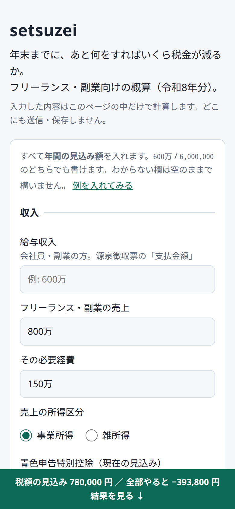

# setsuzei

[](https://github.com/ozko00/setsuzei/actions/workflows/ci.yml)

**ブラウザ版: <https://ozko00.github.io/setsuzei/>**（インストール不要。入力はブラウザの中だけで処理します）

> A CLI, in-browser calculator, TypeScript library, and Agent Skill that estimates how much Japanese income tax and resident tax a freelancer or side-job worker can still save before year-end.
> Covers furusato nozei (hometown tax donation) limits, iDeCo, Small Enterprise Mutual Aid, and the blue-return special deduction for tax year 2026 (Reiwa 8).
> Every rate and threshold is taken from primary sources (National Tax Agency, MIC, e-Gov) and cited in the data file. Estimates only; not tax advice.

**年末までに、あと何をすればいくら税金が減るか**を概算する道具です。フリーランス・副業のエンジニア向け。令和8年分（2026年分）に対応しています。

年間の見込みの収入・経費・家族構成を入れると、いまの所得税・住民税の見込みと、**ふるさと納税・iDeCo・小規模企業共済・青色申告特別控除**でそれぞれいくら減るか、全部やるといくら減るかが出ます。

<p>
  
  
</p>

上はブラウザ版の実際の画面、下は同じ入力をコマンドラインで実行した結果です。どちらも同じ計算コアを使い、同じ数字になります。

```console
$ setsuzei --revenue 800万 --expenses 150万 --blue 65 --social-insurance 90万 --ideco-paid 27.6万 --furusato-paid 3万
setsuzei 0.2.0 ｜ 令和8年分（2026年分）の概算

■ 現状の見込み
  事業所得（青色申告特別控除 650,000 円を控除後）  5,850,000 円
  合計所得金額                                     5,850,000 円
  所得税の課税所得（税率 20%）                     3,976,000 円
  所得税 + 復興特別所得税                            375,400 円
  住民税（令和9年度・均等割と森林環境税を含む）      404,600 円
  税額の合計                                         780,000 円

■ 年末までにできることと、減る税額の目安
                                           合計      所得税     住民税
  ふるさと納税（あと 93,000 円）      93,000 円   19,000 円  74,000 円
  iDeCo（あと 540,000 円）           164,300 円  110,300 円  54,000 円
  小規模企業共済（あと 840,000 円）  241,700 円  154,800 円  86,900 円
  ※ それぞれ単独で実行した場合の軽減額です。まとめて実行した場合の合計は下の「全部やった場合」を見てください。

  ◆ 全部やった場合（ふるさと納税 + iDeCo + 小規模企業共済）
    ふるさと納税の追加       43,000 円
    iDeCo の追加            540,000 円
    小規模企業共済の追加    840,000 円
    追加で支払う額の合計  1,423,000 円
    税額の合計（実行後）    386,200 円
    減る税額の合計          393,800 円
    　うち所得税            214,300 円
    　うち住民税            179,500 円
    ・3 つをまとめて実行した場合の税額を計算し直した値です。各策の軽減額を足した額とは一致しません。
    ・ふるさと納税は、掛金を追加した後の上限の目安（73,000 円）まで寄附する前提です。

  （このあと、策ごとの内訳・注意点・免責が続きます）
```

> [!IMPORTANT]
> 結果は概算です。税理士や税務署・市区町村の判断に代わるものではありません。重要な判断の前に、必ず専門家か所轄の窓口に確認してください。

- 税率・控除額・上限は、国税庁・総務省・e-Gov などの**一次情報で確かめた数値だけ**を使い、数値ごとに出典の URL を付けています（[`src/data/2026.ts`](src/data/2026.ts)）。
- 入力は手元だけで処理します。ブラウザ版は外部と通信せず、CLI もネットワークを使いません。
- CLI・ブラウザ版・TypeScript ライブラリ・Agent Skill の 4 通りで使えます。

## 30 秒で試す

### ブラウザ版

<https://ozko00.github.io/setsuzei/> を開くだけです。「例を入れてみる」を押すと、上の画面と同じ入力が入ります。

URL に CLI と同じ名前のパラメータを付けると、入力済みの状態で開けます（例: [`?revenue=800万&expenses=150万&blue=65`](https://ozko00.github.io/setsuzei/?revenue=800万&expenses=150万&blue=65)）。入力内容は保存も送信もしません。

### CLI

Node.js 20 以上と git が必要です。npm には未公開なので、GitHub から直接実行します（初回は取得とビルドで 10 秒ほどかかります）。

```sh
npx github:ozko00/setsuzei          # 対話形式で入力
npx github:ozko00/setsuzei --revenue 800万 --expenses 150万 --blue 65 --social-insurance 90万
```

毎回 `npx github:...` と打つのが面倒なら、インストールすると `setsuzei` コマンドとして使えます。

```sh
npm install -g github:ozko00/setsuzei
setsuzei --revenue 800万 --expenses 150万 --blue 65 --social-insurance 90万
```

以下の例は `setsuzei` と書いています。インストールしない場合は `npx github:ozko00/setsuzei` に読み替えてください。

## 使い方

### フラグで入力

金額は円です。`600万` / `6,000,000` / `6000000` のどの書き方でも指定できます。すべて**年間の見込み額**を入れます。

```sh
# 会社員の副業（雑所得）、配偶者控除あり、高校生の子 1 人
setsuzei --salary 600万 --revenue 120万 --expenses 20万 --misc \
  --social-insurance 88万 --spouse-income 0 --dependents 1
```

| フラグ | 内容 |
| --- | --- |
| `--salary` | 給与収入（源泉徴収票の「支払金額」） |
| `--revenue` / `--expenses` | フリーランス・副業の売上 / 必要経費 |
| `--misc` | 売上を雑所得として扱う（既定は事業所得） |
| `--blue none\|10\|55\|65` | 現在見込んでいる青色申告特別控除（既定 `none` = 白色申告） |
| `--social-insurance` | 社会保険料（国民健康保険・国民年金・給与天引き分など） |
| `--ideco-paid` / `--kyosai-paid` | iDeCo / 小規模企業共済の掛金（年末までの支払見込み） |
| `--furusato-paid` | ふるさと納税の寄附済み額 |
| `--spouse-income` / `--spouse-70` | 配偶者の合計所得金額 / 配偶者が 70 歳以上 |
| `--income-adjustment` | 所得金額調整控除の対象（給与収入 850 万円超で、23 歳未満の扶養親族＜16 歳未満の子を含む＞か特別障害者がいる場合）。19〜22 歳の扶養親族を入力したときは自動で対象になります |
| `--dependents` / `--dependents-specific` / `--dependents-elderly` / `--dependents-elderly-cohabiting` | 扶養親族の人数（16〜18 歳・23〜69 歳 / 19〜22 歳 / 70 歳以上 / 同居老親等） |
| `--other-deductions` | その他の所得控除の合計（医療費控除・生命保険料控除など） |
| `--ideco-limit` | iDeCo の年間拠出限度額（省略時は就業形態から推定） |
| `--ideco-add` / `--kyosai-add` | 追加する掛金（省略時は上限までの残り枠） |
| `--nhi-rate` | 国民健康保険料の所得割の料率の合計（%）。指定したときだけ、青色申告の区分による翌年度の国保料（所得割）の差の目安を出す |
| `--json` | JSON で出力 |
| `--sources` | 根拠にした一次情報の一覧 |

全部の一覧は `setsuzei --help` で確認できます。

### JSON で入力・出力

```sh
setsuzei --input examples/freelancer.json
echo '{"businessRevenue":8000000,"businessExpenses":1500000,"blueReturn":"65","socialInsurance":900000}' \
  | setsuzei --input - --json
```

入力のキーは [`src/core/types.ts`](src/core/types.ts) の `TaxInput`、出力は `SetsuzeiResult` です。入力に誤りがあると終了コード 2 で終わり、`--json` を付けていれば標準エラーに `{"error": {"issues": [...]}}` を出します。

### ライブラリとして使う

計算コアは実行時依存ゼロの純粋関数です。`npm install github:ozko00/setsuzei` で入ります。

```ts
import { calculate } from "setsuzei";

const result = calculate({
  businessRevenue: 8_000_000,
  businessExpenses: 1_500_000,
  blueReturn: "65",
  socialInsurance: 900_000,
});

result.baseline.totalTax;        // 現状の所得税 + 住民税
result.measures.furusato.limit;  // ふるさと納税の上限の目安
result.measures.ideco.saving;    // iDeCo を残り枠まで拠出した場合の軽減額
result.measures.combined.saving; // ふるさと納税 + iDeCo + 小規模企業共済を全部やった場合の軽減額
```

### Agent Skill として使う

[`skills/setsuzei/SKILL.md`](skills/setsuzei/SKILL.md) は、Claude Code などのエージェントが聞き取りをして、計算を必ずこの CLI に任せるための Skill です（モデルには税額を暗算させません）。

```sh
# Claude Code の場合: 個人用の Skill として置く
mkdir -p ~/.claude/skills && cp -r skills/setsuzei ~/.claude/skills/
```

そのうえで「今年あといくら節税できる？」のように聞くと、エージェントが必要な項目を質問し、CLI の結果をもとに答えます。

## 何を計算し、何を計算しないか

### 計算するもの

- 給与所得（給与所得控除、子ども・特別障害者等がいる場合の所得金額調整控除）、事業所得・雑所得、合計所得金額
- 所得税と復興特別所得税（令和8年分）
- 住民税の所得割・調整控除・均等割・森林環境税（令和8年中の所得に課される令和9年度分）
- 所得控除: 基礎控除、配偶者控除・配偶者特別控除、扶養控除、社会保険料控除（入力値）、小規模企業共済等掛金控除、寄附金控除、その他（入力値）
- ふるさと納税: 自己負担が概ね 2,000 円で済む寄附額の上限の目安と、上限まで寄附した場合の軽減額・自己負担額
- iDeCo・小規模企業共済: 上限までの残り枠と、追加で拠出した場合の軽減額
- 青色申告特別控除: 白色 / 10 万円 / 55 万円 / 65 万円それぞれの税額と、現在の区分との差
- 全部やった場合: ふるさと納税・iDeCo・小規模企業共済をまとめて実行した場合の軽減額（各策の軽減額の足し算ではなく、まとめて計算し直した値）
- 国民健康保険料への影響（任意）: 所得割の料率を入力したときだけ、青色申告の区分による翌年度の所得割額の差の目安

### 計算しないもの

- 国民健康保険料の全体額（均等割・平等割、世帯のほかの加入者の分、賦課限度額、軽減）、国民年金保険料・介護保険料の金額
- 個人事業税、消費税（インボイス・2割特例など）、源泉徴収税額・予定納税の精算
- 住民税の非課税判定、自治体独自の均等割の上乗せや減免
- 分離課税の所得（株式・配当・不動産の譲渡など）、不動産所得、退職所得、一時所得、年金
- 住宅ローン控除などの税額控除、給与と年金の両方がある場合の所得金額調整控除、特定親族特別控除、障害者・ひとり親・寡婦・勤労学生控除（所得控除は「その他の所得控除」に金額を入れれば反映できます）
- 損失の繰越控除、青色事業専従者給与、家事按分の妥当性
- iDeCo・小規模企業共済の受取時の課税、運用成績、手数料

### 簡略化している前提

- 入力はすべて「年末までの年間見込み額」として扱います。月割りや年の途中の変化は見ません。
- 社会保険料は入力値をそのまま社会保険料控除にします。国民健康保険料は自治体ごとに計算が違うため推定しません。
- 事業の所得は「売上 − 経費 − 青色申告特別控除」です。青色申告特別控除は事業所得の黒字が限度です。事業所得の赤字は給与所得と通算し、雑所得の赤字は通算しません。
- 給与所得は国税庁 No.1410 の計算式どおり（収入 660 万円未満は 4,000 円単位に切り下げ）に計算します。
- 住民税は標準税率（所得割 10%、均等割 4,000 円 + 森林環境税 1,000 円）で計算します。所得が少なくても非課税にはせず、均等割と森林環境税の 5,000 円を計上します。
- 住民税の「その他の所得控除」は、指定がなければ所得税と同額とします（実際は生命保険料控除などで額が違います。`--other-deductions-resident` で指定できます）。
- 税額の端数は、所得税 + 復興特別所得税、住民税の所得割とも 100 円未満を切り捨てます。源泉徴収や予定納税との精算前の年税額です。
- ふるさと納税の上限は「住民税所得割額 × 20% ÷（90% − 所得税率 × 1.021）+ 2,000 円」を 1,000 円未満切り捨てにした目安で、確定申告をする前提です（ワンストップ特例は扱いません）。ふるさと納税以外の寄附金は扱いません。
- ふるさと納税の特例分に定額の上限（193 万円）を設ける改正は、令和10年度分の住民税（2027 年中の寄附）からの適用なので、令和8年分の計算には入れていません。
- iDeCo の年間上限は、給与収入がなければ国民年金第1号被保険者（月額 68,000 円 × 12）、給与収入があれば「企業年金のない会社員」（月額 23,000 円 × 12）と仮定します。企業年金がある方・公務員の方は `--ideco-limit` で指定してください。2026 年 12 月施行の限度額引上げは、12 月分の掛金が翌年 1 月の納付になるため、令和8年分には反映していません。
- 小規模企業共済は「掛金月額の上限 70,000 円 × 12 か月」を年間の上限とし、給与収入がある場合・雑所得の場合は対象外として計算しません。加入資格の判定はしません。
- 青色申告の区分の比較は税額の差だけを出します。その区分の要件（承認申請、複式簿記、e-Tax など）を満たせるかは判定しません。
- 各策の軽減額は、その策だけを実行した場合の額です。「全部やった場合」は、iDeCo と小規模企業共済を追加したうえで、下がった後の上限までふるさと納税をする前提でまとめて計算し直します。青色申告の区分は現在のままです。
- 国民健康保険料は自治体ごとに料率が違うため、料率は入力値です。所得割は「総所得金額等 − 住民税の基礎控除 43 万円」に料率を掛けた額で、賦課限度額には当てません。iDeCo・小規模企業共済・ふるさと納税はこの算定基礎を減らさないので、国保料が変わるのは青色申告の区分を変えた場合だけです。
- 所得金額調整控除（給与収入が 850 万円を超え、23 歳未満の扶養親族か特別障害者がいる場合に、850 万円を超える部分＜1,000 万円まで＞の 10% を給与所得から引く）は、`--income-adjustment` を付けたときと、19〜22 歳の扶養親族を入力したときに適用します。16 歳未満や 16〜18 歳の子だけがいる場合は入力から判別できないので、`--income-adjustment` を付けてください。付け忘れると、税額はやや高め、ふるさと納税の上限は数千円高めに出ます。
- 配偶者・扶養親族は、入力された人数・所得がそのまま控除の要件（生計を一にする、所得要件、年齢など）を満たすものとして扱います。

## 根拠にした一次情報

税率・控除額・上限などの数値は [`src/data/2026.ts`](src/data/2026.ts) にまとめ、数値ごとに出典の URL をコメントで付けています（2026-11-24・25 閲覧）。`setsuzei --sources` でも一覧を表示できます。

| 内容 | 出典 |
| --- | --- |
| 令和8年度税制改正（基礎控除・給与所得控除の引上げ等） | [国税庁 令和8年度税制改正による所得税の基礎控除の引上げ等について](https://www.nta.go.jp/users/gensen/2026kiso/index.htm) |
| 所得税の税率・復興特別所得税 | [国税庁 No.2260](https://www.nta.go.jp/taxes/shiraberu/taxanswer/shotoku/2260.htm)、[復興財源確保法 第13条](https://laws.e-gov.go.jp/law/423AC0000000117) |
| 基礎控除 | [国税庁 No.1199](https://www.nta.go.jp/taxes/shiraberu/taxanswer/shotoku/1199.htm) |
| 給与所得控除 | [国税庁 No.1410](https://www.nta.go.jp/taxes/shiraberu/taxanswer/shotoku/1410.htm) |
| 所得金額調整控除 | [国税庁 No.1411](https://www.nta.go.jp/taxes/shiraberu/taxanswer/shotoku/1411.htm)、[租税特別措置法](https://laws.e-gov.go.jp/law/332AC0000000026) 第41条の3の11（住民税は [地方税法](https://laws.e-gov.go.jp/law/325AC0000000226) 第313条第2項により同じ計算） |
| 青色申告特別控除 | [国税庁 No.2072](https://www.nta.go.jp/taxes/shiraberu/taxanswer/shotoku/2072.htm) |
| 小規模企業共済等掛金控除 | [国税庁 No.1135](https://www.nta.go.jp/taxes/shiraberu/taxanswer/shotoku/1135.htm) |
| ふるさと納税（所得税） | [国税庁 No.1155](https://www.nta.go.jp/taxes/shiraberu/taxanswer/shotoku/1155.htm) |
| 配偶者控除・配偶者特別控除・扶養控除 | 国税庁 [No.1191](https://www.nta.go.jp/taxes/shiraberu/taxanswer/shotoku/1191.htm)、[No.1195](https://www.nta.go.jp/taxes/shiraberu/taxanswer/shotoku/1195.htm)、[No.1180](https://www.nta.go.jp/taxes/shiraberu/taxanswer/shotoku/1180.htm) |
| 住民税の税率・均等割・森林環境税 | [総務省 個人住民税](https://www.soumu.go.jp/main_sosiki/jichi_zeisei/czaisei/czaisei_seido/150790_06.html) |
| ふるさと納税（住民税） | [総務省 ふるさと納税ポータルサイト](https://www.soumu.go.jp/main_sosiki/jichi_zeisei/czaisei/czaisei_seido/furusato/mechanism/deduction.html) |
| 住民税の所得控除・調整控除・寄附金税額控除・端数処理 | [地方税法](https://laws.e-gov.go.jp/law/325AC0000000226) 第20条の4の2、第314条の2、第314条の3、第314条の6、第314条の7 |
| ふるさと納税の特例分の割合（復興特別所得税を織り込んだ 84.895% など） | [地方税法](https://laws.e-gov.go.jp/law/325AC0000000226) 附則第5条の6 |
| 住民税の配偶者・扶養親族の所得要件 62 万円（令和9年度分から） | [地方税法 令和9年1月1日施行の条文](https://laws.e-gov.go.jp/law/325AC0000000226/20270101_508AC0000000002) 第292条第1項第7号・第9号、令和8年法律第2号 附則第3条第2項・第11条第2項 |
| 令和9年度住民税の改正点（給与収入への換算の参考） | [江戸川区 令和9年度 税制改正の住民税における主な改正点](https://www.city.edogawa.tokyo.jp/e013/kurashi/zeikin/juminzei/r9kaisei.html) |
| iDeCo の拠出限度額 | [厚生労働省 2026年12月からiDeCoがパワーアップ！](https://www.mhlw.go.jp/web_magazine/column/20261020.html)、[iDeCo公式サイト](https://www.ideco-koushiki.jp/start/) |
| 国民健康保険料（税）の所得割の算定基礎 | [地方税法](https://laws.e-gov.go.jp/law/325AC0000000226) 第703条の4第6項、[国民健康保険法施行令](https://laws.e-gov.go.jp/law/333CO0000000362) 第29条の7第2項第4号 |
| 小規模企業共済の掛金・加入資格 | 中小機構 [掛金](https://kyosai-web.smrj.go.jp/customer/skyosai/installment/index.html)、[加入資格](https://kyosai-web.smrj.go.jp/skyosai/entry/index_02.html) |

### テストでの突き合わせ

公表されている計算例と同じ結果になることをテストで確かめています（[`test/`](test)）。

- 国税庁: 所得税の具体例（No.2260）、給与所得の表（No.1410）、「源泉所得税の改正のあらまし」の基礎控除と給与収入の対応表
- 中小機構: 掛金の節税額一覧表（課税所得 5 通り × 掛金 4 通り）
- 総務省: 「全額控除されるふるさと納税額（年間上限の目安）」の表（[資料](https://www.soumu.go.jp/main_content/000816463.pdf)）。下の「総務省の目安の表との差」を見てください。

このほか、税率や控除額が切り替わる境界値と、条文の式から手計算した期待値のテストがあります。

### 総務省の目安の表との差

総務省の表は当時の税制（所得税の基礎控除 48 万円）で作られているので、基礎控除だけ当時の額に戻して計算し、表と比べています（[`test/published-furusato.test.ts`](test/published-furusato.test.ts)）。資料には計算の前提が書かれていないため、社会保険料はどの行も「給与収入の 15%」、子 1 人は高校生、子 2 人は大学生と高校生と置いています。

| 給与収入 | 独身 | 夫婦＋子 1 人 | 夫婦＋子 2 人 |
| --- | --- | --- | --- |
| 500 万円 | 一致（6.1 万円） | 一致（4.0 万円） | 一致（2.8 万円） |
| 750 万円 | 一致（11.8 万円） | 一致（8.7 万円） | 一致（7.6 万円） |
| 1,000 万円 | 17.7 万円（表 18.0 万円、−3,000 円） | 15.3 万円（表 15.7 万円、−4,000 円） | 14.0 万円（表 14.4 万円、−4,000 円） |
| 2,000 万円 | 52.0 万円（表 56.9 万円、−49,000 円） | 50.3 万円（表 55.2 万円、−49,000 円） | 48.7 万円（表 53.6 万円、−49,000 円） |

- 500 万・750 万円の 6 マスは千円単位まで一致します。
- 1,000 万・2,000 万円の行には差が残ります。所得金額調整控除を実装しても、**表との差そのものは小さくなっていません**（子ありのマスは実装前 +1,000 円 / −44,000 円 → 実装後 −4,000 円 / −49,000 円）。
- 実装で変わったのは差の出方です。実装前は独身と子ありで差が食い違っていましたが、実装後は行ごとにほぼ同じ額にそろいました。「独身と比べて子がいるといくら上限が下がるか」は、表と 1,000 円以内で合います。
- 残る差は家族構成によらない要因で、高収入の行で表が社会保険料を 15% より低く置いていることが原因とみられます。ただし資料に前提の記載がなく確認できないので、前提を表に合わせて動かすことはしていません。社会保険料は入力値をそのまま使うので、実際の額を入れれば、この前提の違いは利用時の結果には影響しません。

なお、令和8年分は基礎控除が引き上げられたため、同じ収入でも総務省の表より上限が低く出ることがあります（例: 給与収入 500 万円・独身は 6.1 万円 → 5.7 万円。所得税率が 10% から 5% に下がるためです）。

## 開発

```sh
npm ci
npm run typecheck   # 型チェック（CLI・ライブラリとブラウザ版）
npm test            # テスト（node:test）
npm run build       # dist/ にビルド（CLI・ライブラリ）
npm run build:site  # docs/js にビルド（ブラウザ版。web/ か src/ を変えたら実行してコミット）
scripts/verify-docker.sh   # CI と同じ手順を Docker の Node 20 / 22 / 24 で実行
```

- 計算コア: [`src/core/`](src/core)（純粋関数、実行時依存なし）
- 年分ごとの税制データ: [`src/data/`](src/data)
- CLI: [`src/cli.ts`](src/cli.ts)、[`src/cli/`](src/cli)
- ブラウザ版: [`web/`](web)（スクリプト）、[`docs/`](docs)（配信する静的ファイル。`docs/js` はビルド結果）

計算結果がおかしい、数値が古い、対応してほしい制度がある、といった場合は [Issue](https://github.com/ozko00/setsuzei/issues/new/choose) を立ててください。数値を直す変更には一次情報の URL が必要です。手順は [CONTRIBUTING.md](CONTRIBUTING.md) にあります。

## 免責

このソフトウェアが出す数値は、入力値と上記の簡略化した前提にもとづく**概算**です。実際の税額は、申告内容・適用される特例・お住まいの自治体などによって変わります。税務の助言ではなく、税理士や税務署・市区町村の判断に代わるものではありません。このソフトウェアの利用によって生じた損害について、作者は責任を負いません（[MIT License](LICENSE)）。

## ライセンス

[MIT](LICENSE)
